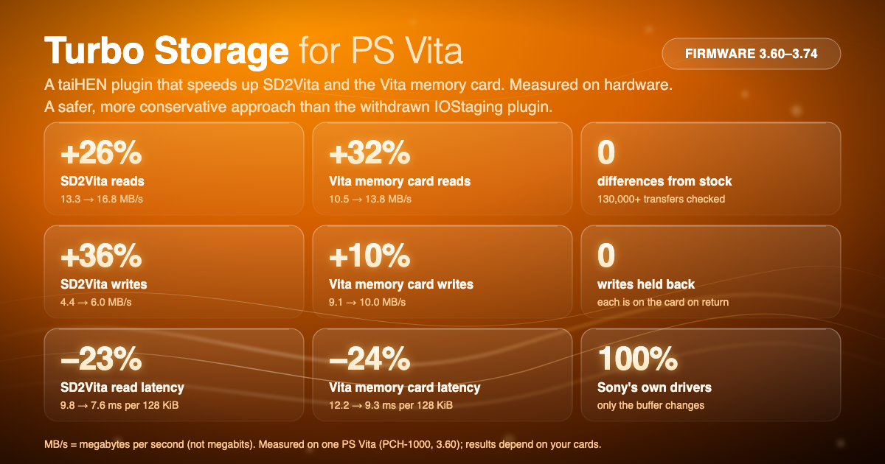
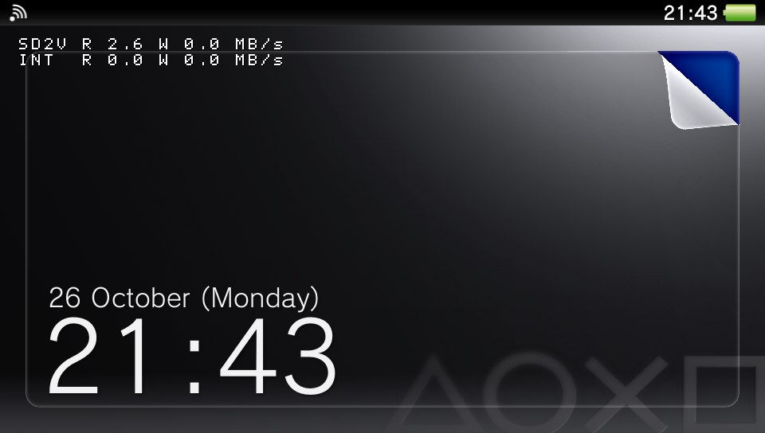
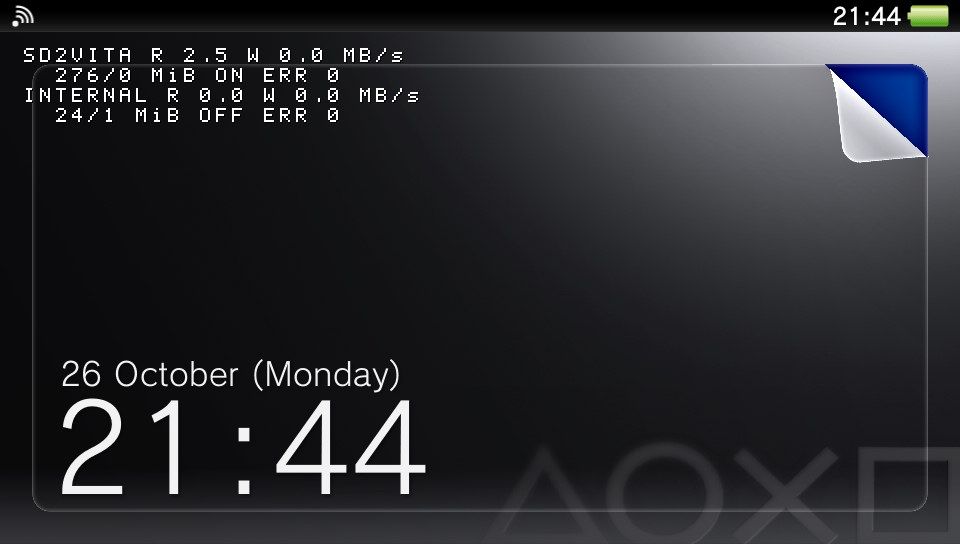
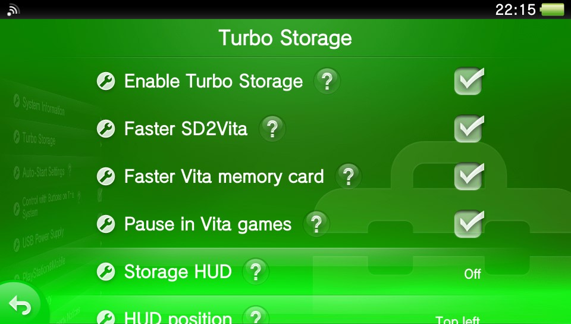
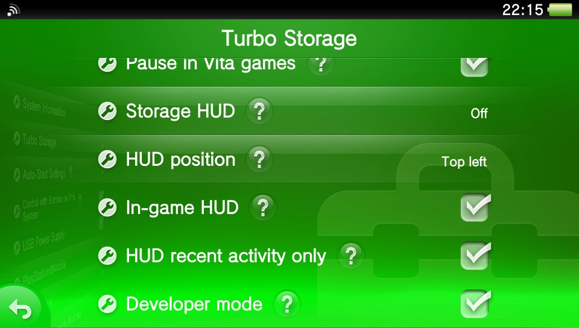

<div align="center">

# 🚀 Turbo Storage for PS Vita

**Faster SD2Vita and Vita memory card, with the system's own drivers doing all the work.**

A taiHEN plugin (kernel module + Settings page) for HENkaku/Ensō on firmware 3.60–3.74.



</div>

> [!IMPORTANT]
> **Early release.** Turbo Storage is built for firmware **3.60 to 3.74**, but so far
> it has only been tested on one console: a PCH-1000 at 3.60 with an SD2Vita and an
> official 4 GB memory card. Treat
> it as experimental. Read the [Disclaimer](#disclaimer), keep a backup of your
> memory card, and if something doesn't work, please
> [open an issue](https://github.com/juanjsebgarcia/vita-turbo-storage/issues) with your
> logs.

---

## Why

Every time the Vita reads or writes storage, the system first cleans and then
invalidates the CPU's data cache over the whole buffer involved. That work is done
one block at a time, and the transfer waits for it. On an SD2Vita it takes about
**40% of the time** of every read, so a card on a bus that can move ~22 MB/s
delivers about 13.

Turbo Storage hands the system's storage driver a buffer that needs no cache
maintenance, then copies the data to where it was going. The driver still sends
every command, handles every error and moves the data; only the buffer changes.

## Headline figures

Measured on the test console (PCH-1000, firmware 3.60, a 128 GB microSD card in an
SD2Vita and an official 4 GB PS Vita memory card). 64 MiB per
run, stock and Turbo Storage
alternated so card behaviour can't favour either side, every run checked
byte-for-byte afterwards.

| | Stock | Turbo Storage | Change |
|---|---|---|---|
| SD2Vita reads (1 MiB requests) | 13.3 MB/s | **16.8 MB/s** | **+26%** |
| SD2Vita reads (128 KiB requests) | 12.4 MB/s | **15.7 MB/s** | **+27%** |
| SD2Vita writes | 4.4–5.4 MB/s | **6.0–6.3 MB/s** | **+17–36%** |
| Vita memory card reads (1 MiB requests) | 10.5 MB/s | **13.8 MB/s** | **+32%** |
| Vita memory card writes (1 MiB requests) | 9.1 MB/s | **10.0 MB/s** | **+10%** |
| Data checked against stock | | **130,000+ transfers, 0 differences** | |

Writes vary a lot from run to run because the card itself pauses to reorganise
its flash; the write figures are averages over three or four alternated rounds.

### Latency

How long each single read takes, timed call by call (median, and the slowest 1%
in brackets). Three alternated rounds, same console.

| Read size | Stock | Turbo Storage | Change |
|---|---|---|---|
| SD2Vita, 32 KiB | 3.3 ms (3.6) | **2.3 ms (2.7)** | **−31%** |
| SD2Vita, 128 KiB | 9.8 ms (10.5) | **7.6 ms (8.7)** | **−23%** |
| SD2Vita, 1 MiB | 73.9 ms (79.3) | **59.0 ms (62.2)** | **−20%** |
| Vita memory card, 32 KiB | 3.6 ms (3.9) | **2.9 ms (3.0)** | **−22%** |
| Vita memory card, 128 KiB | 12.2 ms (12.8) | **9.3 ms (9.5)** | **−24%** |
| Vita memory card, 1 MiB | 95.1 ms (96.6) | **72.2 ms (73.2)** | **−24%** |

The slowest reads improve as much as the typical ones. Requests under 32 KiB take
the standard path and are unchanged (see random reads below for why small file reads
still gain). Writes are 0–15% quicker per call; their
occasional multi-second pauses come from the card itself, with or without Turbo
Storage.

### Random reads

Reads from random places in a 64 MiB file, one at a time, as a game or emulator
reading assets would. Operations per second (IOPS) and throughput; three alternated
rounds, every read checked against the data written.

| Storage, read size | Stock | Turbo Storage | Change |
|---|---|---|---|
| SD2Vita, 4 KiB | 277 IOPS (1.1 MB/s) | **353 IOPS (1.4 MB/s)** | **+28%** |
| SD2Vita, 32 KiB | 268 IOPS (8.8 MB/s) | **332 IOPS (10.9 MB/s)** | **+24%** |
| SD2Vita, 128 KiB | 91 IOPS (12.0 MB/s) | **116 IOPS (15.2 MB/s)** | **+27%** |
| SD2Vita, 1 MiB | 12 IOPS (13.4 MB/s) | **16 IOPS (17.3 MB/s)** | **+29%** |
| Vita memory card, 4 KiB | 276 IOPS (1.1 MB/s) | **348 IOPS (1.4 MB/s)** | **+26%** |
| Vita memory card, 32 KiB | 269 IOPS (8.8 MB/s) | **342 IOPS (11.2 MB/s)** | **+27%** |
| Vita memory card, 128 KiB | 80 IOPS (10.6 MB/s) | **106 IOPS (14.0 MB/s)** | **+32%** |
| Vita memory card, 1 MiB | 10 IOPS (11.0 MB/s) | **13 IOPS (14.6 MB/s)** | **+33%** |

Small random reads gain too: for a 4 KiB read from a new place, the file system
fetches a whole cluster from the card, which is big enough for the faster path
(4 KiB and 32 KiB reads run at the same rate).

### Random writes

Writes to random places in the same file, timed call by call (typical write, the
median). Two alternated rounds.

| Storage, write size | Stock | Turbo Storage | Change |
|---|---|---|---|
| SD2Vita, 4 KiB | 7.3 ms | **6.5 ms** | **−11%** |
| SD2Vita, 32 KiB | 4.0 ms | **3.7 ms** | **−8%** |
| SD2Vita, 128 KiB | 18.2 ms | **16.8 ms** | **−8%** |
| SD2Vita, 1 MiB | 137 ms | **125 ms** | **−9%** |
| Vita memory card, 4–128 KiB | 350–370 ms | 350–370 ms | none |
| Vita memory card, 1 MiB | 464 ms | **454 ms** | **−2%** |

Random writes are mostly the card's own work, so Turbo Storage helps them least.
The Vita memory card takes about a third of a second for every scattered write,
whatever its size; the SD2Vita's microSD card sometimes pauses for over 2 seconds
on one write, with or without Turbo Storage (the SD2Vita 4 and 32 KiB figures are
from the round without those pauses). Large sequential writes, such as copies and
installs, gain more (see the headline figures).

**What you'll notice:** faster copies, VPK installs and anything that reads or
writes big files. **What you won't:** most game loading. A game launch I measured
spent only about 4% of its time waiting for storage; the rest is the game itself.

## Features

- 🚀 **Faster SD2Vita.** Reads and writes on a microSD card in an SD2Vita adapter
  (off by default; turn it on in Settings).
- 💳 **Faster Vita memory card.** The same for the official PS Vita memory card, wherever
  your storage manager mounts it (off by default). Turbo Storage also tells you if the
  system's own memory card "slow mode" is on, which deliberately pauses after every
  transfer; it never changes it.
- 🎮 **Pauses in Vita games.** While a PS Vita or PSP game is in front, storage
  runs at standard speed; the Home screen, Settings, the PlayStation Store and
  homebrew such as file managers keep the faster path. On by default. See
  [Pause in Vita games](#pause-in-vita-games).
- 🎛️ **One switch for everything.** *Enable Turbo Storage* turns every storage
  off and back on without losing your per-storage choices, from Settings or, with
  the optional quick menu row, from the PS button quick menu mid-game.
- ⚠️ **Tells you when it isn't working.** If a storage is running at standard
  speed when you asked for faster (after an error, on unsupported firmware, in
  safe mode), its Settings help text says why, and the HUD flags an error.
- 📊 **Live HUD.** Optional read/write speed, in the corner you choose. It shows over apps and games by
  default; turn off *In-game HUD* to keep it to the Home screen, Settings and the quick menu.
- 🎛️ **Native Settings page.** Everything lives in *Settings → System → Turbo
  Storage*, in your system language.
- 🛡️ **Safe by design.** The system's own driver does all the work, writes are
  never held back, and any error drops that storage back to standard by itself.
  See [Safety](#safety).
- 🛠️ **Developer mode.** An optional command port for diagnostics (see
  [Remote control](#remote-control-port-1340)).

## Use cases

### 📦 Installing and moving big files
VPK installs, copying folders in VitaShell, and unpacking or backing up large
files all spend their time reading and writing storage. Reads are a quarter to a
third faster, and writes gain too, by how much depends on the card.

### 🎮 Emulators and big homebrew
Anything that streams large files from the card while it runs, such as disc
images in emulators or homebrew with big asset files, should read them faster (I haven't measured
specific emulators yet). Native
Vita games mostly don't wait on storage, so expect little change there.

## Screenshots

| Live HUD (compact) | Live HUD (extended) |
|---|---|
|  |  |

| Settings page | Settings page (continued) |
|---|---|
|  |  |

*The HUD shots were captured during an FTP download from the SD2Vita, so Wi-Fi sets the speed shown.*

## Options

### Settings → System → Turbo Storage

| Option | What it does | Default |
|---|---|---|
| Enable Turbo Storage | Main switch. Off: every storage runs at standard speed, whatever the rows below say, and those choices are kept for when you turn it back on. Also in the quick menu with the [optional quick menu row](#quick-menu-row-optional) | On |
| Faster SD2Vita | The faster path for an SD2Vita in the game-card slot | Off |
| Faster Vita memory card | The faster path for the official PS Vita memory card | Off |
| Pause in Vita games | Standard speed while a PS Vita or PSP game is in front; the faster path everywhere else. See [Pause in Vita games](#pause-in-vita-games) | On |
| Storage HUD | Off, Compact (one line per storage in use) or Extended (adds totals and errors) | Off |
| HUD position | Top left, top right, bottom left or bottom right | Top right |
| In-game HUD | Also show the HUD over games and apps. When off, it shows only on the Home screen, in Settings and in the quick menu (press the PS button) | On |
| HUD recent activity only | Only show a storage while it's in use: it appears when it's read or written and drops off after 30 seconds without activity. With nothing in use, the HUD hides, so it may look empty or not appear until there's some storage activity | On |
| Developer mode | Opens the command port on TCP 1340 | Off |

Every option takes effect **immediately, with no reboot**, and is saved. Switching a
storage off sends its next transfer the standard way; switching it back on resumes the
faster path (and retries after an error).

> [!TIP]
> **For maximum stability, leave *Pause in Vita games* on.** The gains are in
> storage-heavy jobs: installing VPKs, copying files and downloading large files.
> Most games barely wait on storage, so you lose almost nothing when Turbo
> Storage steps aside while you play, and it does so by itself. For anything
> else, *Enable Turbo Storage* switches everything off and on instantly, with no
> reboot, from Settings or the quick menu.

### Pause in Vita games

With this on, Turbo Storage works out which app is in front, from the app
presenting frames on screen, and which app each transfer belongs to:

| In front | Storage |
|---|---|
| A retail PS Vita game (title IDs `PCSA`–`PCSH`, and the Japanese, Asian and Korean cartridge IDs) | Standard speed |
| A PSP game, in Sony's PSP emulator or Adrenaline | Standard speed |
| The Home screen, Settings, the PlayStation Store and other system apps | Faster path |
| Homebrew: file managers, emulators, ports and other apps | Faster path |

Once a game is in front, every transfer runs at standard speed, including any
the system makes on its behalf. Before its first frame, the game's own reads are
recognised as they happen. The faster path resumes about two seconds after you
leave the game (pressing the PS button to go to the Home screen, for example);
opening the quick menu over a game doesn't resume it. Games are recognised by their title ID, so a homebrew app
that uses a retail-style title ID counts as a game.

### Remote control (port 1340)

With **Developer mode** on, Turbo Storage listens on TCP port 1340 on your local
network. One command per line:

| Command | Does |
|---|---|
| `status` | Settings, per-storage status and counters |
| `set <key> <value>` | `enabled`, `sd2vita`, `memcard`, `game_pause`, `verify`, `devmode`, `hud_game`, `hud_recent` (0/1), `hud` (0–2), `hud_pos` (0–3) |
| `ping` | Checks the kernel module answers |
| `version`, `help` | |

`verify` is a diagnostic for bug reports, not a Settings option: it reads every
faster transfer a second time the standard way and compares, so with it on,
storage is slower than without the plugin.

```sh
printf 'status\n' | nc -w 3 <vita-ip> 1340
```

The port has no password. Leave Developer mode off unless you're testing.

## How it compares

Turbo Storage isn't the first attempt at this. **IOStaging** (2023) by
[bythos14](https://github.com/bythos14) was built on the same observation, and was
the inspiration for this project. Its author later withdrew it, suspecting it of
corrupting data. Turbo Storage takes a deliberately more conservative approach:

| | Turbo Storage |
|---|---|
| Storage driver | **Unchanged.** Turbo Storage only swaps the buffer handed to the system's own read and write functions; it doesn't re-implement any driver code |
| Writes | **Never cached or deferred.** A write has reached the card before the call returns, exactly as without the plugin |
| Copies | Done by the CPU, which keeps the data cache consistent. No extra DMA tricks |
| Small transfers | **Left alone.** Anything under 32 KiB, which includes the file system's own bookkeeping, takes the standard path |
| Errors | **Fall back to standard.** Any error on the faster path switches that storage back to standard for the session, and finishes the same request the standard way |
| Scope | Only the SD2Vita and the official memory card. The built-in storage (which holds the system's partitions), game cards, USB storage and Wi-Fi are not touched |
| Unknown firmware | Turbo Storage checks the storage driver is one it knows and does nothing otherwise |

Tested so far on the test console: real app data byte-identical to stock (130,000+
verified transfers), two
programs using the card at once, suspend and resume, and running alongside YAMT.

## Compatibility

- **Consoles:** PS Vita PCH-1000 tested. PCH-2000 and PS TV should work (same storage
  system) but are untested.
- **Firmware:** 3.60 to 3.74. The storage driver is the same across all of them;
  on any other firmware Turbo Storage stays inactive.
- **Storage:** SD2Vita (microSD in the game-card slot) and the official PS Vita
  memory card. The console's built-in storage is never touched: it also holds the
  system's own partitions, and the risk outweighs the gain. Game cards and USB
  storage (PSVSD, PS TV USB) are not accelerated. USB storage has nothing to gain: Sony's USB storage driver already
  moves data through a buffer that needs no cache maintenance, the same technique
  Turbo Storage brings to the SD2Vita.
- **Storage managers:** works with YAMT (tested). StorageMgr and gamesd work at a
  different layer and should be compatible, but are untested.
- **Overclocking plugins:** compatible. Overclocking speeds up stock storage a little
  on its own; with Turbo Storage on, it adds little more.
- **Wi-Fi Turbo:** compatible. No measurable effect on Wi-Fi in my tests.

## Limitations

- Most game loading isn't storage-bound, so expect little change there.
- Everything the console's processor reads is identical to standard, but one
  thing differs: after a faster read the data can sit in the processor's cache
  for a moment before it reaches main memory. A game that loads a file straight
  into memory the graphics chip reads, without flushing, could in principle draw
  a stale texture. Nothing on the card is affected. Sony's own USB storage driver
  (PSVSD, PS TV) ends every read the same way, so games already run with this
  pattern there. Still, this is why every storage starts off and why
  [Pause in Vita games](#pause-in-vita-games) is on by default.
- Transfers into or out of non-cacheable memory (where games typically keep
  graphics data) always take the standard path: the system already moves those
  at full speed, and the faster path would only add a copy. They show as `nc=`
  in the log.
- Writes are limited mostly by the card itself.
- Uses 256 KiB of kernel memory for each storage you switch on (none while
  they are all off), plus 256 KiB once verify mode has been used. The memory is
  taken when a storage is switched on and kept until the next restart. If the
  console has none to spare, that storage stays at standard speed and shows
  "no buffer"; switch that storage's own row off and on again to retry.

## Languages

The Settings page follows your system language. Supported:

Japanese, English (US), English (UK), French, Spanish, German, Italian, Dutch,
Portuguese (Portugal), Portuguese (Brazil), Russian, Korean,
Chinese (Traditional), Chinese (Simplified), Finnish, Swedish, Danish,
Norwegian, Polish and Turkish.

Only English is written by a person; the others are machine translations, and
corrections are welcome (see [CONTRIBUTING.md](CONTRIBUTING.md)). The HUD uses a
compact ASCII font, so it's translated for the Latin-script languages and shows
English for the others.

## Disclaimer

This software is provided **"as is", without warranty of any kind**, express or
implied, including but not limited to the warranties of merchantability, fitness
for a particular purpose and non-infringement. It changes how your console reads
and writes its storage. **You use it entirely at your own risk.** The author is
not responsible for any damage, **data loss or corruption**, bricked or unusable
systems, lost warranty, or any other harm resulting from installing or using it.
**Back up your memory card and SD card before installing**, and make sure you know
how to boot without plugins (hold **L** at boot). See the [MIT License](LICENSE)
for the full terms.

Turbo Storage is an unofficial project, not affiliated with or endorsed by Sony
Interactive Entertainment. PlayStation and PS Vita are trademarks of their
respective owners.

## Install

**Requirements:** a PS Vita or PS TV with HENkaku or Ensō (taiHEN) on firmware 3.60
to 3.74, and an SD2Vita for the main feature.

1. Download `storageturbo_kernel.skprx`, `storageturbo.suprx` and
   `storageturbo_settings.suprx` from the
   [releases page](https://github.com/juanjsebgarcia/vita-turbo-storage/releases).
2. Copy all three files to `ur0:tai/`, for example with VitaShell over FTP or USB.
3. **Find your config file.** If `ux0:tai/config.txt` exists, edit **that** one:
   taiHEN reads it first and ignores `ur0:tai/config.txt`. Otherwise edit
   `ur0:tai/config.txt`. Keep the `ur0:tai/...` paths for the plugin files either
   way.

   Add one line under each of three sections:

   | Section | Line to add |
   |---|---|
   | `*KERNEL` | `ur0:tai/storageturbo_kernel.skprx` |
   | `*main` | `ur0:tai/storageturbo.suprx` |
   | `*NPXS10015` | `ur0:tai/storageturbo_settings.suprx` (adds the Settings page) |

   A typical file afterwards looks like this:

   ```
   *KERNEL
   ur0:tai/storageturbo_kernel.skprx
   *main
   ur0:tai/henkaku.suprx
   ur0:tai/storageturbo.suprx
   *NPXS10015
   ur0:tai/henkaku.suprx
   ur0:tai/storageturbo_settings.suprx
   *NPXS10016
   ur0:tai/henkaku.suprx
   ```

4. **Reboot the Vita** (a "Refresh taiHEN config" is not enough). Then open
   *Settings → System → Turbo Storage* and turn on **Faster SD2Vita** and/or
   **Faster Vita memory card**. Both are off until you do.

**To update Turbo Storage:** replace every Turbo Storage file you have (the three above, and
`storageturbo_qm.suprx` if you use it) together, then reboot; mixing versions isn't
supported. Coming from v0.3.0 or earlier, also copy the new `storageturbo_settings.suprx`;
your `config.txt` can stay as it is (`storageturbo.suprx` under `*NPXS10015` then loads the
page for you), or change that line to `storageturbo_settings.suprx`. **To uninstall:**
remove the three lines from `config.txt`, reboot, then delete the files and
`ur0:data/turbostorage/`.

The Settings page is its own module so that SceShell, whose memory the Home screen,
LiveArea, downloads and PSN sign-in share, carries only a few kilobytes of Turbo Storage.

### Quick menu row (optional)

Adds a *Turbo Storage* on/off row to the PS button quick menu, so you can switch
everything off and on in the middle of a game. It is a separate, optional file
that needs [QuickMenuReborn](https://github.com/Ibrahim778/QuickMenuReborn), the
community library other plugins use for their quick-menu rows.

1. Install QuickMenuReborn if you don't have it yet: copy
   `QuickMenuReborn.suprx` to `ur0:tai/` and add it under `*main` in your
   config file, then copy `qmr_plugin.rco` to `ur0:QuickMenuReborn/`.
2. Copy `storageturbo_qm.suprx` from the release to `ux0:QuickMenuReborn/` if
   that folder exists, otherwise to `ur0:QuickMenuReborn/`. It doesn't go in
   `config.txt`: QuickMenuReborn loads it.
3. Reboot, wait a few seconds on the Home screen, then press the PS button.

The row shows the current setting each time the menu opens and is the same
switch as *Enable Turbo Storage* in Settings. To remove it, delete
`storageturbo_qm.suprx`.

> Another plugin's uninstaller may remove QuickMenuReborn along with its own
> files; if the row disappears, reinstall QuickMenuReborn.

## Build

Requires Docker (the build uses a pinned VitaSDK image), or your own VitaSDK with
`$VITASDK` set.

```sh
make                          # builds build/storageturbo_kernel.skprx, build/storageturbo.suprx,
                              # build/storageturbo_settings.suprx and build/storageturbo_qm.suprx
make install VITA_IP=<ip>     # uploads the first three to ur0:tai/ over vitacompanion FTP
make install-qm VITA_IP=<ip>  # uploads the quick menu row to ur0:QuickMenuReborn/
make deploy  VITA_IP=<ip>     # install, then reboot the Vita
make log     VITA_IP=<ip>     # fetch the logs into ./logs/
make config                   # print the config.txt lines
```

## Safety

- **Safe mode.** If the Vita restarts or crashes while Turbo Storage is starting
  (before the Home screen appears), the next boot runs with Turbo Storage inactive,
  so a problem can never lock you into a boot loop. A *Safe mode* row then appears at
  the top of *Settings → System → Turbo Storage*: untick it and restart the Vita to
  turn everything back on. (By hand: write `0` to `ur0:data/turbostorage/boot_guard`.)
  A normal restart after the Home screen has appeared never triggers it.
- **Automatic fallback.** Any error on the faster path switches that storage back to
  standard for the session. Switching it off and on in Settings retries.
- **Firmware check.** On a storage driver it doesn't recognise, Turbo Storage
  installs nothing.
- **Escape hatch.** Holding **L** at boot skips every plugin.
- **Logs.** `ur0:data/turbostorage/kernel.log` and `user.log` record what Turbo
  Storage did, including the console model and the other kernel plugins loaded.
  Until the Home screen is up, every line is saved at once, so even a start that
  crashes leaves its log. After a crash, the safe-mode line names the step that
  start had reached (also in `boot_guard`). Please attach `kernel.log`,
  `kernel.old.log`, `user.log` and `boot_guard` to bug reports.

## Contributing

See [CONTRIBUTING.md](CONTRIBUTING.md). Test reports from other consoles,
firmware versions and SD cards are especially welcome.

## Credits

Built on [taiHEN](https://github.com/yifanlu/taiHEN),
[VitaSDK](https://vitasdk.org) and
[vitacompanion](https://github.com/devnoname120/vitacompanion). The quick menu row uses
[QuickMenuReborn](https://github.com/Ibrahim778/QuickMenuReborn) (MIT). The Settings page
and HUD follow [Wi-Fi Turbo](https://github.com/juanjsebgarcia/vita-turbo-wifi). Thanks to the
PS Vita homebrew community, and especially to [bythos14](https://github.com/bythos14),
whose IOStaging spotted the problem first and inspired Turbo Storage.

Thanks also to [Osaul4ik](https://github.com/Osaul4ik), whose fork
[vita-memio](https://github.com/Osaul4ik/vita-memio) found that transfers into
non-cacheable memory are faster the standard way.

## License

[MIT](LICENSE) © 2026 Juan Garcia Alvite
